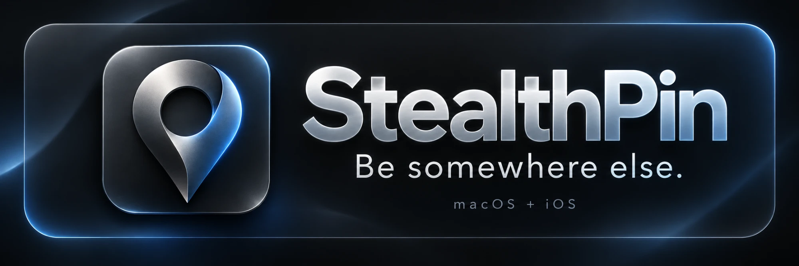

<p align="center"></p>

# StealthPin

StealthPin changes where your iPhone appears in Find My, Maps and every other app. Since 0.2.0 the
iPhone does it by itself: pick a spot on the phone and the location holds wherever you take it, with
no computer around. The Mac app sets up iPhones on iOS 18 to 26 and is the big screen for planning.

This repository only holds the built releases. The source code is private. More about StealthPin is at
[stealthpin.com](https://stealthpin.com).

## What it does

- Set your iPhone's location anywhere on the map, or to a saved bookmark or favorite.
- Travel there instead of teleporting: drive, walk or cycle along real roads, taking as long as the
  real trip would.
- Traffic that behaves like traffic: speeds that suit each road, red lights and stop signs, and
  rush-hour stop-and-go.
- Natural GPS drift while the phone sits still, so the location doesn't look frozen.
- Slip away without a jump: hold where you really are while you leave, and end the trip back wherever
  you like.
- Replay trips you actually recorded, with their real stops and pace, a little differently each time.
  GPX import and export on the Mac.
- Schedules on the iPhone: at the office 9 to 5 on weekdays, and it leaves in time to get there. Times
  vary a little from day to day, and it can suggest a day from where you've been.
- What Others See: each time Find My shared your location, and whether friends got the fake spot or
  the real one.
- Back to Real Location from the app, the Lock Screen, Control Center, Siri or the Mac. Restarting the
  iPhone also switches faking off.
- On the iPhone, a hold log, a notification if holding stops while the phone's in your pocket, and a
  line saying which spot friends in Find My see.
- On the Mac, a checklist of what can still give you away, warnings when the iPhone's battery runs low,
  and an alert if a restart has put it back at its real location.
- Keeping it quiet: a dark Stealth map, an option to keep the Lock Screen blank or hide the place
  name, a discreet mode on the iPhone with a plain app icon, and on the Mac a Touch ID lock, no history, a plain or hidden menu bar icon, and Erase
  Everything.

## The iPhone app

You need an iPhone on iOS 18 or later, with **Developer Mode** turned on (Settings › Privacy &
Security › Developer Mode). The switch appears once StealthPin is installed. The
[step-by-step guide](https://stealthpin.com/developer-mode) explains it in plain language.

StealthPin isn't on the App Store, because Apple doesn't allow apps that use the iPhone's developer
settings. There are two ways to install it, both explained at
[stealthpin.com/install](https://stealthpin.com/install):

- **Sideload it.** Download `StealthPin-iPhone.ipa` from [Releases](../../releases) on the iPhone and
  install it with [SideStore](https://sidestore.io), AltStore or Sideloadly. A copy signed with your
  own Apple ID can't carry a VPN of its own, so it uses the free
  [LocalDevVPN](https://apps.apple.com/us/app/localdevvpn/id6755608044) instead. SideStore refreshes
  it every seven days.
- **Join the beta.** Beta builds carry StealthPin's own VPN and don't need refreshing, but only
  install on registered iPhones. Email your iPhone's UDID to
  [hello@stealthpin.com](mailto:hello@stealthpin.com).

Then open StealthPin and follow its setup. On iOS 27 it pairs with the phone by itself: you type a code
in Settings. On iOS 18 to 26, the Mac app sends a pairing file across once (**Send Pairing File**),
and after that the phone works alone.

StealthPin's VPN never sends anything off the phone. It turns each packet straight back into the
iPhone so the app can reach the phone's own developer tools. iOS runs one VPN at a time, so turning on
another one, such as Tailscale or a work VPN, stops the fake location holding.

## The Mac app

You need a Mac running macOS 15 or later.

1. Download the latest `Stealthpin.zip` from [Releases](../../releases).
2. Unzip it and move **StealthPin** to Applications.
3. Connect your iPhone over USB, tap **Trust**, and open StealthPin. A short tour checks each part of
   the setup and walks you through your first move. If Developer Mode's switch isn't showing on the
   iPhone, click **Show the Switch on My iPhone** in the tour, with the iPhone plugged in and unlocked.
4. Click **Set Up Tunnel** in the tour. The tunnel to the phone has to run as
   root, so StealthPin runs it as a background helper: in System Settings, turn on StealthPin under
   **Allow in the Background**. You do this once, and after that it starts with your Mac. If you're
   coming from 0.1.3 or earlier, restart your Mac once afterwards, because the old tunnel keeps
   running until then and blocks the new one.

The Mac can also set the iPhone's location directly, but on iOS 17 and later that only lasts while the
phone stays near the Mac. To hold a location away from home, use the iPhone app.

StealthPin talks to the phone with [pymobiledevice3](https://github.com/doronz88/pymobiledevice3),
which comes inside the app on Macs with Apple silicon, so there's nothing to install. On an Intel Mac,
install it yourself first:

```bash
uv tool install pymobiledevice3
```

If the macOS firewall is on, allow incoming connections for StealthPin when asked, so the iPhone app
can share bookmarks and trips with it.

## Using it responsibly

StealthPin is for controlling where your own iPhone appears. Faking a location can break the rules of
apps and services that depend on it, and the people you share your location with may be relying on
it, so use it with care.

StealthPin isn't affiliated with or endorsed by Apple. Find My, iPhone and macOS are trademarks of
Apple Inc.
